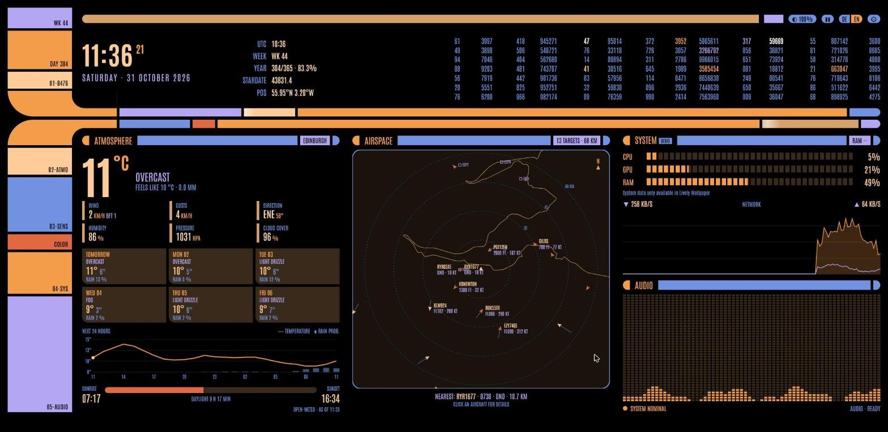
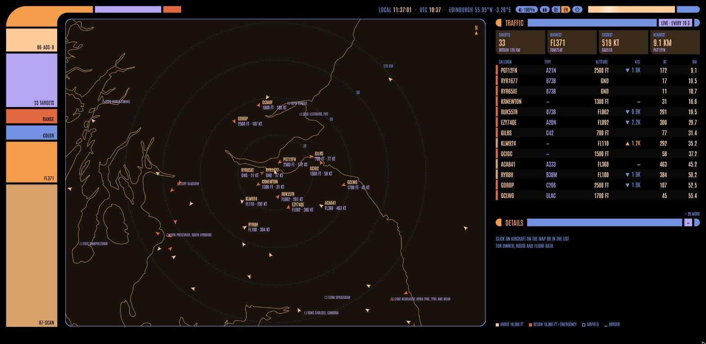
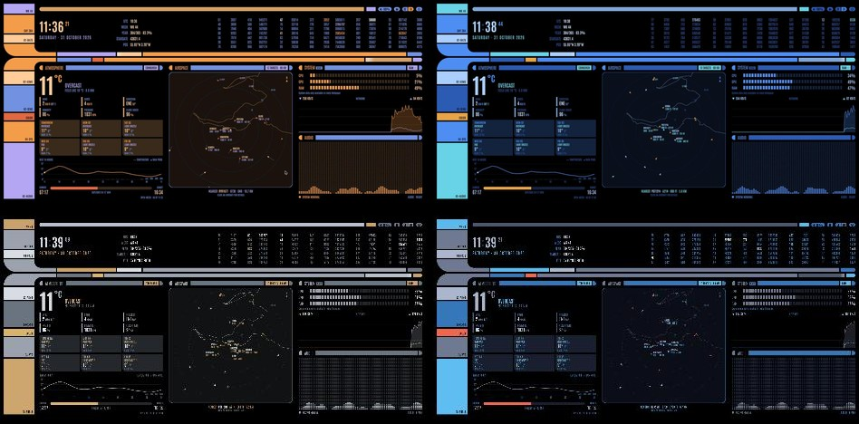

  

I'm not a real Trekkie. I couldn't tell you which deck sickbay is on. But I grew up with **TNG** and **Voyager**, and those glowing computer consoles never quite left my head. So I finally gave my desktop the treatment: **Bridge Ops**, an animated console-style wallpaper for Lively. No official logos, just a lot of rounded bars and a slightly unhealthy love for weather data.

## What's on the console

| | |
|---|---|
| **Weather** | current conditions, 7-day forecast, 24-hour chart |
| **Air & health** | air quality, UV index, pollen |
| **Aviation weather** | METAR/TAF for nearby airports and your favourites |
| **Flight radar** | live traffic, click an aircraft for details, flown track and planned route |
| **Situation view** | rain radar, weather warnings, river levels |
| **System** | load with history, audio visualizer |
| **Stardate** | TNG style, of course |

There's a dimmer and an animation toggle for when the bridge gets too busy, plus English/German (English by default) and metric/imperial.

## Second screen: Airspace

**Bridge Ops – Airspace** turns another monitor into a big live radar: coastlines, airfields, a traffic list sorted by distance and details on click. It uses the same ADS-B relay as the main wallpaper.

## Fits your desktop

Bridge Ops scales to any resolution and screen size, from 1080p to 4K and ultrawide. Set the interface size in the wizard or in Lively's settings.

Your desktop icons get their own space: the **icon zone** keeps a strip on the left free. Set columns, column width and row height to match your icon grid exactly, and a calibration grid shows you where things line up. The taskbar gap is adjustable too, and the frame around the icon zone can be switched off.

## Getting started

1. Download `Bridge-Ops-Lively.zip` (and `Bridge-Ops-Airspace-Lively.zip` for a second screen) from [Releases](../../releases/latest).
2. Drag the zip into Lively and set it as your wallpaper.
3. On first start, the setup wizard asks for your location. Reopen it anytime with the gear button in the top right.
4. *Optional:* enable the flight radar (see below).
5. *Optional:* install the sensor for more system readouts.

The source of both wallpapers is in [`Bridge-Ops-Lively`](Bridge-Ops-Lively) and [`Bridge-Ops-Airspace-Lively`](Bridge-Ops-Airspace-Lively).

> [!TIP]
> **Flight radar:** the free ADS-B services don't allow requests straight from a wallpaper, so the radar needs a tiny relay. `adsb.php` is included. Put it on any web space with PHP and enter its URL in the wizard (guide in `PROXY-HOSTING.txt`). Please run it for yourself only.
>
> No web space? No problem. Everything else works anyway, and the center shows the situation view instead.

> [!NOTE]
> **Bridge-Ops-Sensor (Windows, optional):** adds drive usage, network speed on the right adapter, VRAM and faster load readings. It listens on `127.0.0.1` only and never sends anything anywhere.
>
> The script isn't digitally signed, so Windows SmartScreen will warn you. That's expected. The source is plain text, have a look first if you like.

## Gallery

**Four colour schemes**

Screenshots: live data for Edinburgh.

## The boring but important part

> [!IMPORTANT]
> **Not for real-world decisions.** METAR/TAF and the flight radar are just for fun, never for flight planning or navigation. For weather warnings, only your national weather service counts.

<b>Warranty, privacy, trademarks and license (click to expand)</b>

 

**No warranty.** All data is shown as is and may be delayed, incomplete or wrong. Use at your own risk.

**Privacy.** Settings stay on your computer. To load data, your PC talks directly to the services listed in `LEGAL.txt`, which see your IP address and the coordinates of your location. If you host `adsb.php`, the same goes for your own server.

**Non-commercial.** Free to use and share, but not for commercial purposes, because several data sources only allow non-commercial use.

**Fan project.** Not affiliated with or endorsed by Paramount/CBS or anyone else. Star Trek, TNG and Voyager are trademarks of their respective owners. All artwork is original, no official logos or assets.

**License.** © 2026 E11iot, [CC BY-NC-ND 4.0](https://creativecommons.org/licenses/by-nc-nd/4.0/). Use and share it unchanged with credit, non-commercially. Data sources and fonts keep their own licenses.

**Data:** Open-Meteo, MET Norway, aviationweather.gov, RainViewer, adsb.lol, airplanes.live, hexdb.io, DWD and PEGELONLINE. Full credits in `LEGAL.txt`.

---

Feedback is very welcome, especially from real Trekkies who can tell me everything I got wrong.

*Engage.*
**E11iot**
